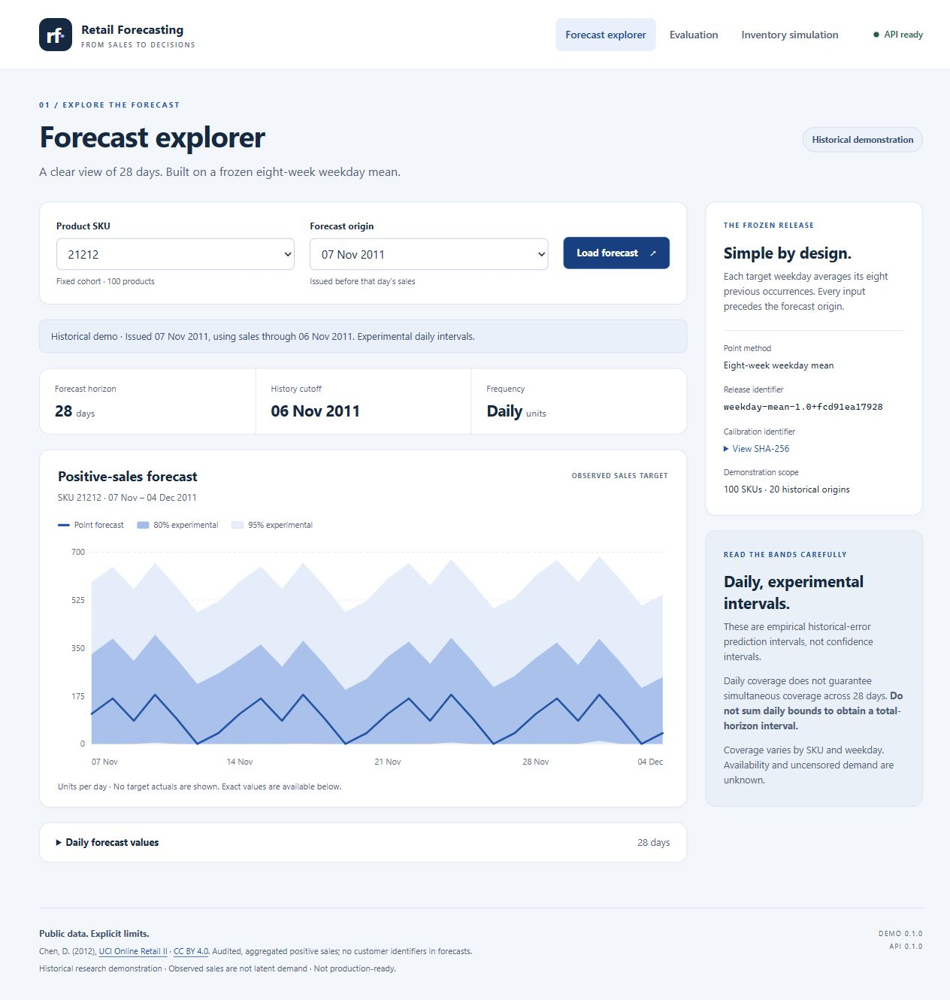
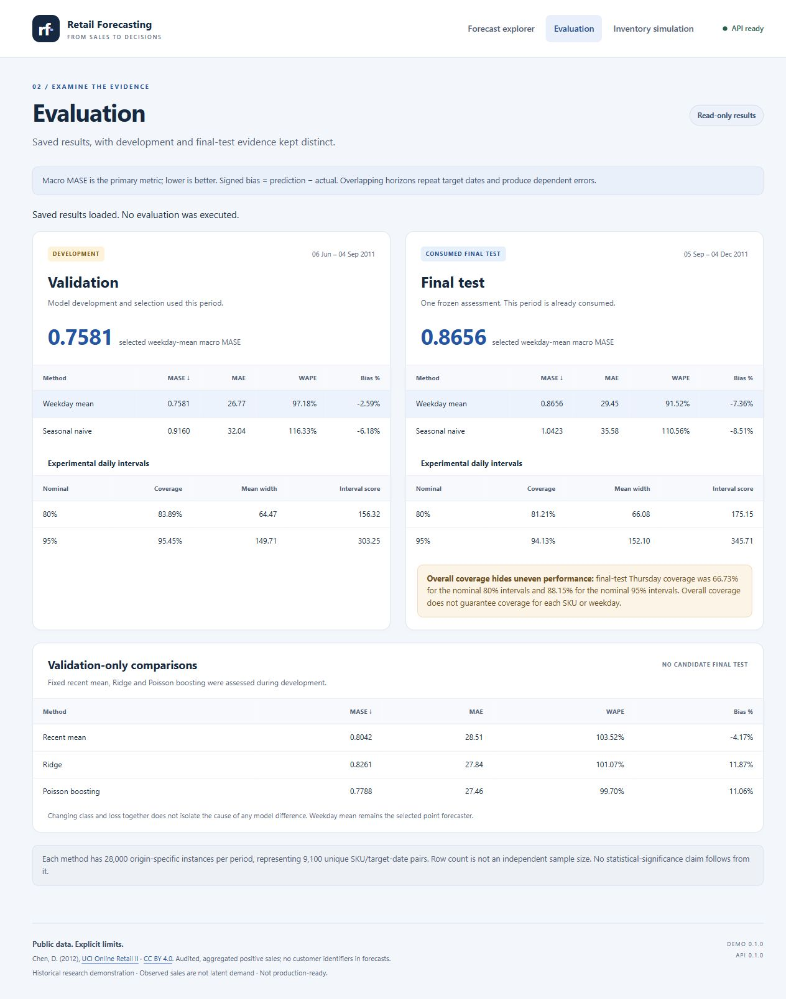
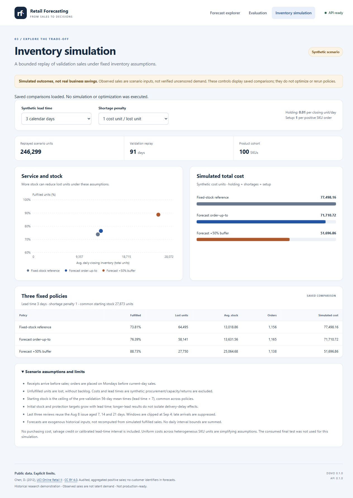
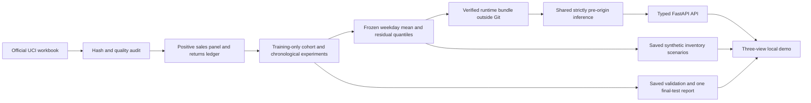

# Retail Forecasting and Inventory Decision Support

[](https://github.com/tanjilaislam414659/retail-forecasting-inventory/actions/workflows/ci.yml)

**[Release v0.1.0](https://github.com/tanjilaislam414659/retail-forecasting-inventory/releases/tag/v0.1.0)** | [Runtime ZIP](https://github.com/tanjilaislam414659/retail-forecasting-inventory/releases/download/v0.1.0/retail-forecasting-runtime-v0.1.0.zip) | [SHA-256 checksums](https://github.com/tanjilaislam414659/retail-forecasting-inventory/releases/download/v0.1.0/SHA256SUMS.txt)

A reproducible **historical demonstration** of retail forecasting, experimental
uncertainty and inventory-policy trade-offs, built with Python, scikit-learn,
FastAPI and Docker on CPU. Development was AI-assisted; claims are tied to saved
results, including experiments where more complex models lost to a simple baseline.

**Frozen forecaster:** eight-week weekday mean | 100 SKUs | daily observed positive
sales | 28-day horizon | 20 supported 2011 origins. This is not a live retail feed,
uncensored-demand estimate or claim of real business savings. Final test is consumed.

## Explore the demonstration

| Forecast explorer | Saved evaluation | Synthetic inventory simulation |
| --- | --- | --- |
|  |  |  |

Actual local captures, not mockups: forecast SKU 21212/origin 2011-11-07; complete
saved evaluation; inventory lead 3/penalty 1. Controls do not run experiments.

## Architecture



Research/export are explicit offline steps. Startup loads processed history and
calibration once. Requests never download data, parse the workbook, fit models,
recalibrate or regenerate evaluation/simulation outputs. Inference computes from
pre-origin history; it does not look up saved evaluation forecasts. Reporting
uses small saved aggregate copies.

## Quick start: Windows / PowerShell

From the repository root, use **CPython 3.13**. Windows checks used 3.13.5; Linux
Docker/CI is pinned to 3.13.18. If `py` is unavailable, use an installed 3.13
interpreter's full path. Preserve an existing environment; no activation, global
package installation, PATH change or PowerShell policy change is needed.

```powershell
# Fresh checkout only; skip creation if .venv already exists.
py -3.13 -m venv .venv
.\.venv\Scripts\python.exe -m pip install --only-binary=:all: --require-hashes -r publication/requirements-ci-windows.lock
.\.venv\Scripts\python.exe scripts/build_demo_package.py --output dist/demo
.\.venv\Scripts\python.exe -m pip install --no-deps dist/demo/retail_forecasting_demo-0.1.0-py3-none-any.whl
.\.venv\Scripts\python.exe -m pip check
.\.venv\Scripts\python.exe -m retail_forecasting.demo --root . --port 8000
```

Open **http://127.0.0.1:8000/**; API docs: **http://127.0.0.1:8000/docs**. Stop with
**Ctrl+C**. The demo wheel is an alternative to the overlapping runtime wheel,
not an add-on to install over it. An existing editable research environment can
run the final module command directly. Builds refuse nonempty output directories.

**Without the runtime bundle**, saved evaluation/inventory views work; readiness
and forecasts correctly return 503, with an explicit unavailable state. For the
historical forecast explorer, extract the separately verified bundle and run:

```powershell
.\.venv\Scripts\python.exe -m retail_forecasting.demo --root artifacts/runtime/milestone-9-v0.1.0 --runtime-bundle --port 8000
```

The attributed runtime ZIP is published with [v0.1.0](https://github.com/tanjilaislam414659/retail-forecasting-inventory/releases/tag/v0.1.0).
Download and verify it before enabling forecasts:

```powershell
New-Item -ItemType Directory -Force artifacts/downloads, artifacts/runtime | Out-Null
$release = "https://github.com/tanjilaislam414659/retail-forecasting-inventory/releases/download/v0.1.0"
Invoke-WebRequest "$release/retail-forecasting-runtime-v0.1.0.zip" -OutFile artifacts/downloads/runtime.zip
Invoke-WebRequest "$release/SHA256SUMS.txt" -OutFile artifacts/downloads/SHA256SUMS.txt
$expected = (Get-Content publication/runtime-attachment.json -Raw | ConvertFrom-Json).sha256
$actual = (Get-FileHash artifacts/downloads/runtime.zip -Algorithm SHA256).Hash.ToLower()
if ($actual -ne $expected) { throw "Runtime ZIP checksum mismatch" }
Expand-Archive artifacts/downloads/runtime.zip artifacts/runtime
```

[Bundle/extraction/raw-acquisition instructions](publication/runtime-bundle.md)
explain both routes. A raw workbook download alone does not recreate the calibrated
release. Do not rerun the consumed final test merely to start the demo.

## Quick start: Docker

Requires Docker Desktop with Linux/amd64 containers and the verified extracted
bundle at `artifacts/runtime/milestone-9-v0.1.0`:

```powershell
docker compose -f demo/compose.yaml -f publication/compose.yaml config
docker compose -f demo/compose.yaml -f publication/compose.yaml build
docker compose -f demo/compose.yaml -f publication/compose.yaml up -d --wait --wait-timeout 90
Invoke-RestMethod http://127.0.0.1:8000/ready
# Open http://127.0.0.1:8000/
docker compose -f demo/compose.yaml -f publication/compose.yaml down
```

The official Python base and Linux dependencies are digest/hash pinned. UID 10001,
read-only root/runtime mounts and host **127.0.0.1:8000** limit this local service;
inside the container it binds to 0.0.0.0. Missing/corrupt artifacts are errors,
never synthetic fallbacks. Build/startup/request paths do no data acquisition or
artifact regeneration. [Detailed demo instructions](demo/README.md).

## Main findings

Audited **1,067,371 source rows** across two sheets and removed **22,523 exact
cross-sheet copies**. Repeated-looking transactions and wholesale extremes were
retained; returns/adjustments were separated from positive sales. Training data
selected the 100-SKU cohort and daily frequency. The pre-observation history mask
is an explicit modelling assumption, not verified product availability.
[Quality audit](docs/data-quality-report.md) | [preparation protocol](docs/milestone-2.md).

### Validation development: model selection

Ten weekly origins, 2011-06-06 through 2011-08-08; targets end 2011-09-04.
Macro per-SKU MASE with frozen seven-day original-training scales is primary.

| Fixed method | Macro MASE (lower is better) | MAE | Pooled WAPE | Relative bias |
| --- | ---: | ---: | ---: | ---: |
| **Eight-week weekday mean (selected)** | **0.7581** | **26.77** | **97.18%** | -2.59% |
| Seasonal naive | 0.9160 | 32.04 | 116.33% | -6.18% |
| Recent 28-day mean | 0.8042 | 28.51 | 103.52% | -4.17% |
| Pooled Ridge, alpha 1 | 0.8261 | 27.84 | 101.07% | +11.87% |
| Fixed pooled Poisson boosting | 0.7788 | 27.46 | 99.70% | +11.06% |

Ridge's macro MASE was **8.96% worse** than weekday mean; boosting's was **2.73%
worse**. Ridge's shared effects missed SKU/weekday structure, overpredicted
zero-sales days and clipped 11.03% of predictions at zero. Boosting improved on
Ridge but still lost to weekday mean and overforecast overall. Extreme orders
remained. Squared-error/Poisson training objectives do not directly optimize
macro MASE; changing class and loss together does not isolate a cause.
[Ridge findings](docs/ridge-comparison.md) | [boosting findings](docs/boosting-comparison.md).

Boosting was **validation-informed development** after Ridge diagnostics, not
untouched holdout evidence. Later origins may use sales already observed before
issue time, never realized sales inside their future 28-day horizon.

### Final test: one frozen, consumed assessment

Ten Monday origins, 2011-09-05 through 2011-11-07; targets end 2011-12-04.
Only the selected forecaster and already-defined reference were evaluated.

| Method | Macro MASE | MAE | Pooled WAPE | Relative bias |
| --- | ---: | ---: | ---: | ---: |
| **Frozen weekday mean** | **0.8656** | **29.45** | **91.52%** | **-7.36%** |
| Fixed seasonal naive | 1.0423 | 35.58 | 110.56% | -8.51% |

Weekday mean's macro MASE was **16.95% lower** than the reference, descriptively;
93/100 SKUs had lower MASE. This did not trigger model switching. Each period has
28,000 origin-specific instances but only 9,100 unique SKU/target-date pairs:
overlapping horizons create dependent errors, not 28,000 independent samples.
No significance claim follows from row count. [Final report](docs/final-evaluation-report.md).

### Experimental intervals and synthetic inventory

| Period | Nominal 80% coverage | Nominal 95% coverage |
| --- | ---: | ---: |
| Validation development | 83.89% | 95.45% |
| Consumed final test | 81.21% | 94.13% |

Original-training residual quantiles stayed frozen. **Overall coverage hides
uneven performance:** final-test Thursday coverage was **66.73% / 88.15%** for
nominal 80%/95% intervals. Overall coverage does not guarantee each SKU or weekday.
These are experimental empirical historical-error prediction intervals, not
confidence intervals or conformal guarantees. Do not sum daily bounds into a
calibrated 28-day total interval.

Inventory replays 91 validation days once per continuous SKU/policy/lead ledger,
using observed positive sales as scenario inputs, **not verified uncensored
demand**. Eighteen fixed comparisons expose trade-offs. At lead 3/penalty 1,
forecast +50% buffer fulfilled 88.73% versus 76.39% for forecast order-up-to, while
average total closing stock rose from 13,631.56 to 25,064.68 units. These are
synthetic outcomes, not business savings. Costs, lead times and initial stock
are artificial; late forecast reuse, terminal clipping, lost-sales handling and
excluded procurement/capacity effects limit interpretation.
[Scenario specification/outcomes](docs/milestone-10.md).

## Tests and reproducibility

Dataset-free CI uses committed **synthetic** history/calibration/report fixtures,
not UCI downloads or ignored datasets. It checks arithmetic, dates/leakage, strict
API schemas, artifact failures, demo reporting and installed package assets.
Runtime/demo distributions are tested in separate environments.

```powershell
# In the fresh demo environment above:
.\.venv\Scripts\python.exe ci/run_tests.py --package demo
.\.venv\Scripts\python.exe ci/check_installed_demo.py
```

Full-data integration/saved-output parity are separate opt-in regression checks,
not new evaluations. Hosted GitHub Actions [passed for the first release](https://github.com/tanjilaislam414659/retail-forecasting-inventory/actions/runs/42471989911):
16 runtime and 24 demo synthetic tests (16 common tests), zero unit-test skips.
Package-specific conditional workflow steps are expected to skip in the other matrix job.
Clean-checkout and publication/history check evidence: [Milestone 12](docs/milestone-12.md).

## Data, licensing and scope

Chen, D. (2012). [Online Retail II](https://doi.org/10.24432/C5CG6D), UCI Machine
Learning Repository, **[CC BY 4.0](https://creativecommons.org/licenses/by/4.0/)**.
Derived reports/bundle data retain attribution and change notices.
[Retrieval/checksums](docs/data-provenance.json) | [dataset notice](deployment/DATASET-ATTRIBUTION.md).
No confidential REWE data is used. Raw/customer-level data, environments, secrets,
models, full generated outputs and runtime bundles stay outside Git.

**Project code: [MIT](LICENSE), copyright (c) 2026 Tanjila Islam.**
UCI-derived data remains [CC BY 4.0](DATA-LICENSE.md), separately from code. This is not
production-ready: fixed historical SKUs/origins; no live ingestion, authentication,
operational inventory integration or load benchmark. Availability, uncensored
demand and causal business impact are unknown.

[Publication proposal/decisions](publication/README.md) | [release notes](publication/release-notes.md) |
[CV bullets/demo walkthrough](publication/portfolio-copy.md).
The original development workspace, Git history and protected research artifacts
remain separate and are not included in this fresh publication history. Scientific
source/configuration hashes remain provenance metadata, not imported commits.

### Release-download verification limitation

The canonical browser-download URLs timed out for the verification clients,
including a hosted runner. The official authenticated release-asset API downloaded
the ZIP successfully and its SHA-256 matches. The release-check workflow records
which route was used; API fallback does not claim anonymous access succeeded.
If browser downloads are unavailable, authenticated GitHub CLI provides the
supported alternative (GitHub CLI is optional, not installed by this project):

```powershell
gh release download v0.1.0 --repo tanjilaislam414659/retail-forecasting-inventory --pattern "retail-forecasting-runtime-v0.1.0.zip" --pattern "SHA256SUMS.txt" --dir artifacts/downloads
```

Verify the committed SHA-256 before extraction. This is a verification-environment
limitation, not evidence that all users will encounter the same network failure.
