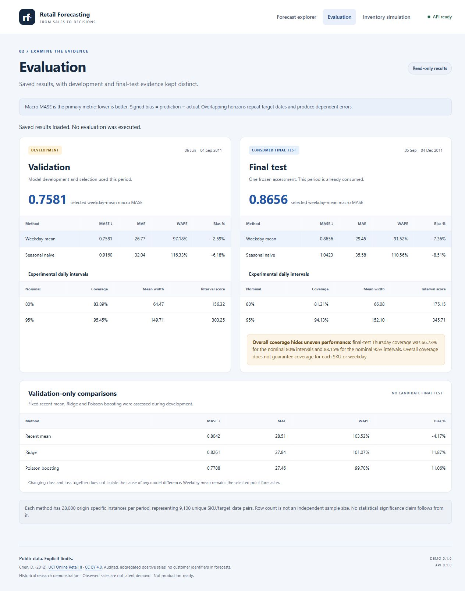

# Retail Forecasting demonstration — interface 0.1.0

A small three-view interface served by FastAPI: forecast explorer, saved evaluation
and saved inventory scenarios. Plain HTML/CSS/JavaScript and native SVG, with no
frontend framework, CDN scripts, external fonts, chart library or build toolchain.
The frozen API/calibration/research releases remain unchanged.

## Evaluation preview



The interval warning uses the existing saved
`data/final_evaluation/interval_metrics_by_target_weekday.csv`: Thursday coverage
is 66.725% for nominal 80% intervals (displayed as 66.73%) and 88.15% for nominal
95% intervals. These match the requested figures; no evaluation was rerun.
Overall coverage does not guarantee coverage for each SKU or weekday.

## Run on Windows

From the existing project environment and repository root:

```powershell
.\.venv\Scripts\python.exe -m retail_forecasting.demo --root . --port 8000
```

Visit **http://127.0.0.1:8000/**. The launcher defaults to loopback. Stop with Ctrl+C.
Existing `/health`, `/ready`, `/metadata`, `/forecast` and `/docs` are still provided
by the original FastAPI factory. The adapter adds `/`, static assets and read-only
`/demo/api/evaluation` and `/demo/api/inventory`. Forecast calculations remain in
the unchanged service; browser JavaScript only renders the response.

## Docker

Use the existing verified runtime bundle from Milestone 9. No export, acquisition,
evaluation or simulation happens during build/startup/requests.

```powershell
docker compose -f demo/compose.yaml build
docker compose -f demo/compose.yaml up -d --wait --wait-timeout 90
# Open http://127.0.0.1:8000/
docker compose -f demo/compose.yaml down
```

The demo is a separate image/tag and wheel; original Docker/runtime files stay
unchanged. It retains the digest-pinned Python 3.13 base, hash-locked dependencies,
UID/GID 10001, read-only root/runtime mount and loopback-only host publication.
Small aggregate reporting copies ship inside the read-only image. The full
research workspace, raw workbooks, simulations and saved forecast files do not.

## What the views mean

- **Forecast explorer:** choose one of 100 supported SKUs and 20 historical origins.
  All 28 points come from `POST /forecast`. The cutoff, release and calibration IDs
  are displayed. Daily 80%/95% intervals are experimental historical-error bands;
  no simultaneous or total-horizon coverage guarantee exists, and bounds must not
  be summed as a calibrated total interval. Exact daily values have an accessible
  table. Display rounding does not change API values.
- **Evaluation:** saved validation development evidence and consumed final-test
  results are separate. Weekday mean and seasonal naive are shown in both periods;
  recent mean, Ridge and Poisson boosting are validation-only comparisons. No fresh
  evaluation occurs. Macro MASE uses frozen training scales; WAPE is pooled, and
  overlapping forecasts are dependent.
- **Inventory:** lead-time/penalty controls select among 18 saved comparisons,
  showing fulfillment, lost units, average stock, order count and synthetic cost.
  No policy is optimized or simulation rerun. Costs, lead times, initial stock,
  terminal handling and stale forecasts are explicit artificial assumptions.

Reporting is packaged once by `scripts/package_demo_reports.py`, which reads saved
aggregate CSV metrics, preserves source hashes and refuses overwrites. It does
not regenerate model/simulation outputs. Startup checks each payload's hash and
loads it once; a missing/corrupt report makes that report unavailable without
inventing numbers or disabling unrelated views. Repair packaged files and restart.
If the forecasting artifacts fail, the explorer shows an unavailable state while
saved reporting remains usable. Existing `/ready` retains forecasting readiness
semantics. Network errors have explicit retry messages and loading announcements.

Native links, buttons/selects, visible focus, skip link, labelled controls, live
statuses, reduced-motion support and numerical table alternatives support keyboard
and screen-reader use. Tables may scroll horizontally on narrow screens. The
interface uses no mouse-only action and no automatic animation.

Data: Chen, D. (2012), [UCI Online Retail II](https://doi.org/10.24432/C5CG6D),
[CC BY 4.0](https://creativecommons.org/licenses/by/4.0/), audited/aggregated positive
sales. Observed sales are not verified uncensored demand. This is a historical
portfolio demonstration, not production-ready or evidence of real business savings.

See `docs/milestone-11.md` for actual test results and representative screenshots.
Build the separate Python distributions with
`.\.venv\Scripts\python.exe scripts/build_demo_package.py --output dist/demo-release`.
The output directory must be empty; existing distributions are preserved. The demo
wheel is an alternative runtime distribution, not an add-on to install over the
original runtime wheel: both contain the same frozen core namespace. Use its
Docker image or a separate environment for wheel installation. The existing
editable project environment already supports the module command above.

Full-data interface/API regression checks (no new performance evaluation):

```powershell
.\.venv\Scripts\python.exe -m unittest discover -s tests -p test_demo.py -v
.\.venv\Scripts\python.exe -m unittest discover -s tests -p test_service.py -v
# With Compose already healthy; uses disposable copies for failure checks:
.\.venv\Scripts\python.exe scripts/verify_demo_container.py --container retail-forecasting-demo-local-demo-1
```

`ci/run_tests.py` remains the separate, dataset-free synthetic core/API suite.
The existing hosted workflow is unchanged and has not been executed on GitHub.
No publication, model work, final evaluation or inventory replay is part of this
interface milestone. Hosted Actions remains pending.
